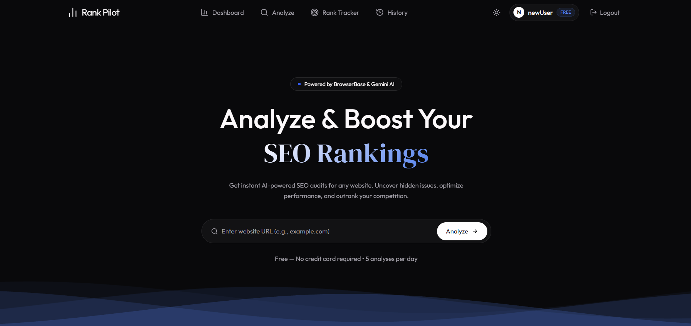
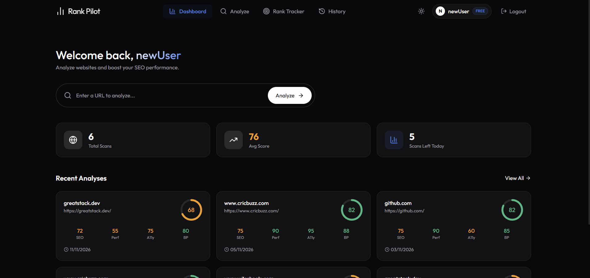
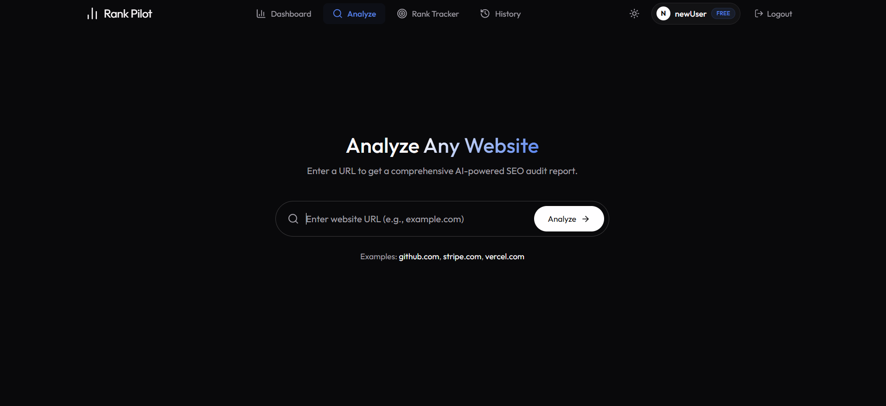
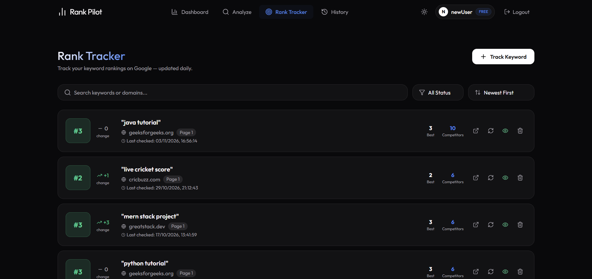
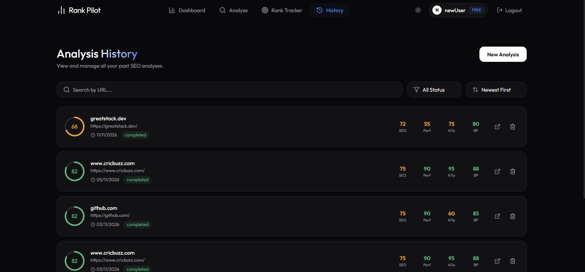

# Rank Pilot 🚀

**Rank Pilot** is an AI-powered SEO analysis and keyword rank-tracking application. It helps users review a website's SEO health, understand important optimization areas, and monitor keyword positions in Google search results through a single dashboard.

The application combines website analysis powered by **Browserbase and Gemini AI** with a workspace for viewing analysis history and tracking keyword rankings.

---

## 📸 Screenshots

### Landing Page
Enter a website URL to start an SEO analysis.



### Dashboard
View account activity, total scans, average SEO score, remaining daily scans, and recent website analyses.



### Website Analysis
Submit a website URL to generate an AI-powered SEO audit report.



### Keyword Rank Tracker
Track keywords and domains, review current positions and ranking changes, and view competitor counts and last-checked information.



### Analysis History
Review previous SEO analyses, their overall scores, category scores, completion status, and analysis dates.



---

## ✨ Features

- **Website SEO analysis** — submit a website URL to start an SEO audit.
- **AI-powered insights** — use Gemini AI to help interpret extracted website data and produce SEO analysis.
- **Website crawling** — use Browserbase with Playwright for browser-based website inspection.
- **SEO score overview** — view an overall score and category scores, including SEO, Performance, Accessibility, and Best Practices.
- **Keyword rank tracking** — monitor keyword positions, ranking changes, best position, and competitor information.
- **Analysis dashboard** — view total scans, average score, daily scan allowance, and recent analyses.
- **Analysis history** — revisit previous reports and review their scores and status.
- **Search and filtering** — search tracked keywords/domains or analysis URLs and filter records by status.
- **Dark user interface** — a dark-themed interface with dashboard navigation.

> Feature availability can depend on the configured backend services and the current account plan.

---

## 🧰 Technology Stack

The project uses the following technologies and services:

| Area | Technologies |
|---|---|
| Frontend | React, TypeScript, Vite |
| Backend | Node.js, Express.js |
| Database | MongoDB, Mongoose |
| AI analysis | Google Gemini API (`@google/genai`) |
| Browser automation | Playwright |
| Cloud browser | Browserbase |
| API communication | Axios / HTTP APIs |
| Report export | jsPDF |

---

## 🏗️ Application Workflow

### Website SEO analysis

1. The user submits a website URL from the Rank Pilot interface.
2. The backend starts the website inspection workflow.
3. Browserbase provides the cloud browser environment and Playwright performs browser automation and extracts website information.
4. The extracted information is sent to Gemini AI for SEO analysis.
5. The analysis result is stored in MongoDB and made available in the dashboard and history.

### Keyword rank tracking

1. The user adds a keyword and the website/domain to track.
2. The backend checks search results using the configured rank-tracking service.
3. Rank information, changes, and competitor data are stored for the tracked keyword.
4. The Rank Tracker interface displays the available ranking information and last-check time.

---

## 📁 Project Structure

The exact folder names may differ depending on your local implementation. A typical layout is:

```text
Rank-Pilot/
├── client/                 # React + TypeScript + Vite frontend
│   ├── src/
│   │   ├── components/
│   │   ├── pages/
│   │   ├── context/
│   │   └── utils/
│   └── package.json
│
├── server/                 # Express backend
│   ├── config/
│   ├── controllers/
│   ├── middleware/
│   ├── models/
│   ├── routes/
│   ├── services/
│   ├── server.js
│   └── package.json
│
├── screenshots/            # README screenshots
└── README.md
```

---

## ⚙️ Getting Started

### Prerequisites

Install the following before running the project:

- Node.js and npm
- MongoDB database (local MongoDB or MongoDB Atlas)
- Google Gemini API key
- Browserbase account and API credentials

### 1. Clone the repository

```bash
git clone <your-github-repository-url>
cd Rank-Pilot
```

### 2. Install backend dependencies

```bash
cd server
npm install
```

Create a `.env` file in the backend directory and add the environment variables used by your backend. For example:

```env
PORT=5000
MONGODB_URI=your_mongodb_connection_string
GEMINI_API_KEY=your_gemini_api_key
BROWSERBASE_API_KEY=your_browserbase_api_key
BROWSERBASE_PROJECT_ID=your_browserbase_project_id
JWT_SECRET=your_jwt_secret
```

Use the exact variable names expected by your source code. Do not commit your real `.env` file or API keys.

Start the backend using the script defined in `server/package.json`, for example:

```bash
npm run dev
```

### 3. Install frontend dependencies

Open another terminal:

```bash
cd client
npm install
```

If the frontend uses an environment variable for the backend URL, create `client/.env` and set it according to the variable name used in your code. For example:

```env
VITE_API_URL=http://localhost:5000
```

Start the frontend:

```bash
npm run dev
```

Open the local URL printed by Vite in your terminal.

---

## 🔐 Environment Variables and Security

- Keep API keys, database credentials, and JWT secrets in environment files.
- Add `.env` files to `.gitignore`.
- Provide an `.env.example` containing placeholder values for collaborators.
- Never publish real Gemini, Browserbase, database, or authentication credentials.
- If a secret is accidentally pushed to a public repository, revoke or rotate it.

---

## 🗺️ Possible Future Improvements

- Scheduled keyword checks and ranking notifications.
- Historical ranking charts and keyword movement trends.
- More detailed competitor comparisons.
- Downloadable and shareable SEO reports.
- Additional SEO recommendations and prioritized action plans.
- More search-engine and location-specific rank tracking options.

---

## 👨‍💻 Author

**Prabhakar Pandey**

 GitHub -: https://github.com/PrabhakarPandey9702
 Linkedin -: www.linkedin.com/in/prabhakar-pandey-244704361
---

## 📄 License

This project is licensed under the [MIT License](./LICENSE).
